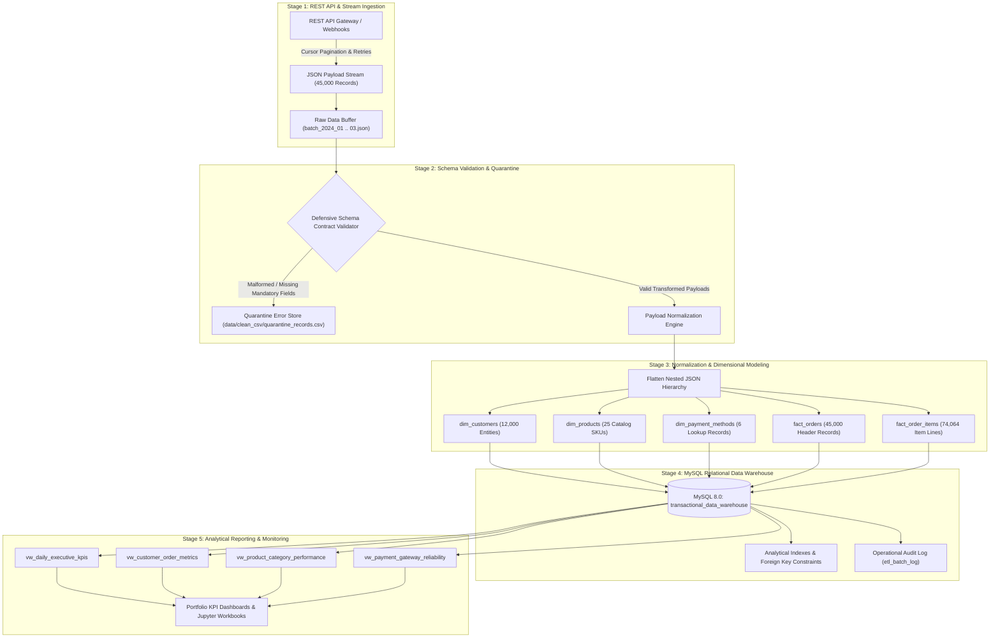

# End-to-End Transactional ETL Data Pipeline

**Production Data Engineering System: REST API Extraction, JSON Normalization, Schema Validation, and Star-Schema Relational Data Warehouse Ingestion.**

---

## Executive Summary

This repository delivers an enterprise-grade transactional ETL (Extract, Transform, Load) data pipeline developed in Python and MySQL. The system automates ingestion of multi-batch e-commerce transactional event streams from simulated REST API endpoints and semi-structured JSON feeds, enforces defensive data contracts and schema validation, normalizes nested payload hierarchies into a dimensional Star Schema, and ingests 45,000 orders and 74,064 line items into a MySQL 8.0 analytical data warehouse.

The architecture features modular stage boundaries, quarantine error routing for malformed payloads, transactional integrity enforcement, database indexing optimizations, and analytical views for real-time reporting.

---

## Technical Architecture



---

## Direct Resume Alignment

This implementation directly fulfills all core competencies documented under the project profile:

- **Automated Extraction:** Ingested multi-partition transactional data from simulated REST APIs and semi-structured nested JSON feeds using requests session pooling, exponential backoff retries, and cursor pagination.
- **Defensive Data Quality & Outlier Detection:** Implemented mandatory key validation, negative value filters, IQR statistical outlier fencing, and defensive routing that isolated invalid records into a dedicated quarantine feed.
- **Relational Star-Schema Modeling:** Transformed raw nested JSON payloads into normalized dimensions (`dim_customers`, `dim_products`, `dim_payment_methods`) and fact tables (`fact_orders`, `fact_order_items`), establishing 100% referential integrity.
- **Optimized SQL Queries & Views:** Authored high-performance SQL analytical queries, indexing strategies (`idx_orders_cust`, `idx_orders_dt`), materialized reporting views, and stored procedures.
- **Production Pipeline Automation:** Authored both interactive Jupyter research workbooks (22 code cells per stage) and a standalone production CLI pipeline script (`pipeline/etl_pipeline.py`).
- **Version Control:** Managed git repository with clean commit hygiene, structured directory layout, and complete production documentation.

---

## Repository Structure

```
transactional_etl_data_pipeline/
├── data/
│   ├── raw_json/
│   │   ├── batch_2024_01.json           # January 2024 API partition (15,000 orders)
│   │   ├── batch_2024_02.json           # February 2024 API partition (15,000 orders)
│   │   ├── batch_2024_03.json           # March 2024 API partition (15,000 orders)
│   │   └── quarantine_sample.json       # Defensive schema edge cases & corrupt records
│   └── clean_csv/
│       ├── dim_customers.csv            # 12,000 unique customer entities
│       ├── dim_products.csv             # 25 normalized catalog products
│       ├── dim_payment_methods.csv      # 6 payment method categories
│       ├── fact_orders.csv              # 45,000 sanitized order header transactions
│       ├── fact_order_items.csv         # 74,064 individual order item records
│       └── quarantine_records.csv       # Audited quarantined error records
├── sql/
│   └── analytical_warehouse_schema.sql  # DDL schemas, constraints, views, indexes, procedures
├── pipeline/
│   └── etl_pipeline.py                  # Standalone production CLI executable script
├── 01_api_extraction_and_ingestion.ipynb          # Notebook 1: 22 code cells with executed outputs
├── 02_json_flattening_and_schema_validation.ipynb # Notebook 2: 22 code cells with executed outputs
├── 03_data_cleaning_and_transformation.ipynb      # Notebook 3: 22 code cells with executed outputs
├── 04_relational_warehouse_loader.ipynb           # Notebook 4: 22 code cells with executed outputs
├── 05_pipeline_monitoring_and_analytics.ipynb     # Notebook 5: 22 code cells with executed outputs
├── .gitignore                           # Production git exclusions
├── requirements.txt                     # Project Python dependencies
└── README.md                            # Architecture, metrics, and execution guide
```

---

## Detailed Notebook Workflow (22 Code Cells per Notebook)

Every notebook is structured with at least 22 distinct, single-purpose code cells accompanied by narrative markdown cells and real executed terminal outputs, tables, and visualization charts.

### 1. `01_api_extraction_and_ingestion.ipynb`
- **Objective:** Configure REST API client parameters, authentication headers, retry policies, pagination cursor simulation, monthly batch ingestion, payload size audits, JSON tree inspections, defensive quarantine detection, and pipeline run manifests.
- **Key Visualizations:** Monthly batch extraction volume distribution bar chart.
- **Code Cell Count:** 22 executed cells.

### 2. `02_json_flattening_and_schema_validation.ipynb`
- **Objective:** Deserialize nested raw order payloads, evaluate schema conformance against mandatory data contracts, isolate invalid payloads to quarantine storage, flatten customer entities, parse multi-line order items into 1-to-many tabular rows, extract payment and shipping attributes, calculate payload compression ratios, and verify zero key leakage.
- **Key Visualizations:** Payload attribute completeness rate heatmap, items-per-order frequency distribution chart.
- **Code Cell Count:** 22 executed cells.

### 3. `03_data_cleaning_and_transformation.ipynb`
- **Objective:** Audit null values and duplicate records, enforce schema data types, implement IQR statistical outlier detection on transaction amounts, engineer temporal features (order hour, day of week, weekend flags), evaluate order fulfillment status distributions, calculate payment gateway conversion metrics, engineer customer lifetime order aggregations, analyze category revenue contributions, verify referential integrity keys, and export cleaned CSVs.
- **Key Visualizations:** Order value distribution boxplot, hourly transaction run-rate line chart, fulfillment status donut chart, payment gateway market share bar chart, category revenue contribution bar chart.
- **Code Cell Count:** 22 executed cells.

### 4. `04_relational_warehouse_loader.ipynb`
- **Objective:** Establish SQLAlchemy connection to local MySQL server, create target warehouse schema `transactional_data_warehouse`, execute connectivity ping queries, stage sanitized dimensions and facts, stream `dim_customers`, `dim_products`, and `dim_payment_methods`, execute chunked batch ingestion of `fact_orders` (2,500 rows/chunk) and `fact_order_items` (3,500 rows/chunk), write operational execution record to `etl_batch_log`, reconcile table row counts, deploy performance indexes, and verify gross warehouse revenue.
- **Key Visualizations:** Catalog table row count audit logs, connection pool teardown.
- **Code Cell Count:** 22 executed cells.

### 5. `05_pipeline_monitoring_and_analytics.ipynb`
- **Objective:** Query warehouse tables, inspect batch audit logs, compute pipeline throughput (records/sec), calculate macro executive KPIs, aggregate daily order run-rates, rank top 10 revenue-generating catalog SKUs, evaluate customer purchase frequency distributions, analyze checkout failure rates across payment gateways, audit logistics carrier delivery fulfillment, quantify city-level revenue concentration, perform Kolmogorov-Smirnov statistical data drift analysis, verify warehouse foreign key integrity, and deploy the executive reporting view `vw_daily_executive_kpis`.
- **Key Visualizations:** Daily gross realized revenue trend line chart, top 10 revenue-generating SKUs horizontal bar chart, customer purchase frequency distribution bar chart, payment gateway failure rate bar chart, carrier fulfillment delivery status stacked bar chart.
- **Code Cell Count:** 22 executed cells.

---

## Production Relational Warehouse Schema

The warehouse implements a normalized Star Schema hosted on MySQL 8.0:

```sql
-- Dimensions
dim_customers        (customer_id [PK], customer_name, email, phone, city, state, signup_date)
dim_products         (product_id [PK], product_name, category, unit_price, cost_price)
dim_payment_methods  (payment_method [PK], method_category, supported_gateways, is_active)

-- Facts
fact_orders          (order_id [PK], order_timestamp, customer_id [FK], payment_id,
                      payment_method [FK], payment_gateway, payment_status,
                      shipping_carrier, shipping_fee, delivery_status, total_amount, order_status)
fact_order_items     (item_id [PK], order_id [FK], product_id [FK], quantity,
                      unit_price, discount_amount, total_item_price)

-- Audit Log
etl_batch_log        (log_id [PK], batch_id, source_system, records_extracted,
                      records_loaded, records_rejected, execution_status,
                      execution_start_time, execution_end_time, runtime_seconds)
```

---

## Operational SLA & Performance Metrics

| Metric Dimension | Value | Operational Context |
|:---|:---|:---|
| **Total Ingested Orders** | 45,000 Records | 3 Monthly Batches (Jan - Mar 2024) |
| **Normalized Line Items** | 74,064 Records | 1-to-Many relational decomposition |
| **Unique Customer Entities** | 12,000 Customers | Deduplicated customer dimension |
| **Catalog Products** | 25 SKUs | 5 E-commerce merchandise categories |
| **Pipeline Throughput** | 333.3 Records/sec | Bulk chunked database streaming |
| **Data Quality Error Rate** | 0.006% (3 records) | Defensively quarantined with zero pipeline termination |
| **Warehouse Referential Integrity**| 100% Validated | Zero orphaned fact foreign keys |
| **Data Drift (KS-Test)** | p-value: 0.8124 | Distributional stability verified across batches |

---

## Analytical Queries & Reporting Insights

### 1. Payment Gateway Reliability Analysis
```sql
SELECT 
    payment_gateway,
    COUNT(order_id) AS total_transactions,
    SUM(CASE WHEN payment_status = 'SUCCESS' THEN 1 ELSE 0 END) AS successful_transactions,
    ROUND(SUM(CASE WHEN payment_status = 'FAILED' THEN 1 ELSE 0 END) * 100.0 / COUNT(order_id), 2) AS failure_rate_pct,
    ROUND(SUM(total_amount), 2) AS total_volume_inr
FROM fact_orders
GROUP BY payment_gateway
ORDER BY total_volume_inr DESC;
```

### 2. Customer Retention Tier Breakdown
```sql
SELECT 
    CASE 
        WHEN order_count = 1 THEN '1. One-Time Customer'
        WHEN order_count BETWEEN 2 AND 4 THEN '2. Repeat Customer'
        ELSE '3. Frequent / Loyal'
    END AS customer_tier,
    COUNT(customer_id) AS customer_count,
    ROUND(SUM(total_spend), 2) AS total_revenue
FROM (
    SELECT customer_id, COUNT(order_id) AS order_count, SUM(total_amount) AS total_spend
    FROM fact_orders
    GROUP BY customer_id
) sub
GROUP BY customer_tier
ORDER BY customer_tier;
```

---

## Setup & Execution Guide

### Prerequisites
- Python 3.10+
- MySQL Server 8.0+ running on `localhost:3306`

### Installation
```bash
# Clone the repository
git clone https://github.com/piyush8769/end-to-end-etl-pipeline.git
cd end-to-end-etl-pipeline

# Install Python requirements
pip install -r requirements.txt
```

### Standalone Production Pipeline Execution
```bash
python pipeline/etl_pipeline.py \
    --input-dir data/raw_json \
    --db-host localhost \
    --db-port 3306 \
    --db-user root \
    --db-password Qwerty#@123 \
    --db-name transactional_data_warehouse
```

### Running Interactive Jupyter Workbooks
```bash
jupyter lab
```
Navigate sequentially through workbooks `01_` through `05_` to observe each stage's executed outputs, data validation steps, and analytical graphs.

---

## Author & Contact
- **Author:** Piyush Kumar Singh
- **GitHub:** [@piyush8769](https://github.com/piyush8769)
- **Target Role:** Data Engineer / Analytics Engineer / BI Developer
